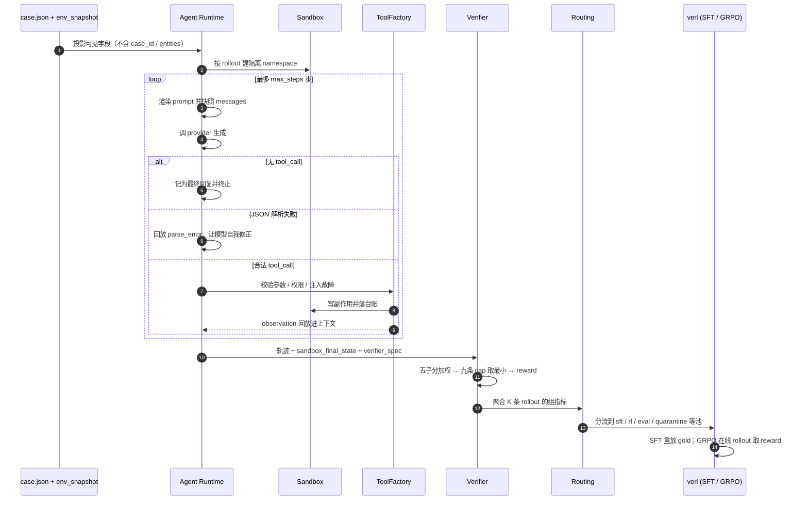

<div align="center">
  <h2>Aftersales Agent</h2>

  <p>
    
    
    
    
    
    
    
  </p>
</div>

<div align="center">

面向售后客服场景的 <strong>Agent 后训练代码包</strong>。

把「会调业务工具的 Agent」放进可控沙箱里跑，用规则判分器逐条打分，再按分数决定这条数据该进 SFT 还是 GRPO。

</div>

## 项目定位

这是一个**训练工程**，不是客服产品。它不提供对话界面、不接真实工单系统，只负责回答一个问题：

> 同一个售后 Agent 模型，在 35 个业务工具、一套政策约束和一个可验证的世界状态下，做得对不对？错在哪一层？错的数据该怎么用它？

围绕这个问题，仓库提供四件东西：可复现的 Agent 运行时、隔离沙箱与确定性环境、五子分 + 九条封顶规则的判分器、以及按能力缺口分流的案例路由。

**它不包含**：训练数据（需外部提供 parquet）、模型权重（需自行下载）、全量规模的实验配置（随包配置均为 smoke 规模）。

## 核心功能

售后 Agent 的难点不在「会不会调工具」，而在于**做了没做要能查、说没说谎要能判、判出来的分能直接喂给训练**。下面四层能力都围绕这一点。

### 🧰 可控的 Agent 运行时

> 一次 rollout 就是一次完整的多轮工具调用，产物可回放、可审计、可校验。

- **双路工具调用解析** — 优先走 provider 原生 `tool_calls`，回退解析 Qwen3 风格的 `<tool_call>{...}</tool_call>` XML 块；能容忍标签内混入 Markdown fence 或解释文字。
- **无调用 ≠ 出错** — 「压根没有 tool_call」被当作面向客户的最终回复（终止），「有标签但 JSON 坏掉」则进入 parse_error 反馈循环，让模型下一步自我修正。这条区分是终止与纠错两条路径能正确分流的前提。
- **prompt 快照留痕** — 每一步都把当时完整的 `messages`、`tool_schemas`、`prompt_hash`、`tool_schema_hash` 深拷贝进轨迹；没有这份记录，训练侧就无法做 rollout / training 一致性审计。
- **协议违规不拦，交给判分** — 一步发多个 tool_call 时 runtime 照实执行并如实记录，由 verifier 判 reward=0。运行时保持忠实，评分负责定标。
- **Provider 可换** — vLLM、OpenAI 兼容 API、本地 Transformers 三选一，由环境变量决定；HTTP 客户端刻意只用标准库 `urllib`，不依赖 openai SDK。

### 🔒 隔离沙箱与确定性世界

> 只读台账给 Agent 看真值，写操作全部落在带命名空间的可写沙箱里。

- **namespace 隔离** — 每条 rollout 的写入都打上 `{run_id}:{case_id}:{rollout_id}`，verl 并发跑同一 case 的多条轨迹时，A 的退款不会被 B 读到。
- **只读 / 可写分离** — 15 张只读业务台账（订单、客户、物流、发票…）不可变；15 个可写台账承接副作用，跑完导出成 `sandbox_final_state` 作为判分的事实地基。
- **台账形状二分** — 多数台账是追加列表（每次写 append 一条），订单/订阅/工单这类「对象当前状态」用 dict 按对象 key 存，后写覆盖先写。
- **故障可注入且不背锅** — `tool_faults` 可注入报错与延迟，标记为 `source="environment"`；模型自己用错工具的报错是 `source="llm"`。两者严格区分，环境制造的故障不计入模型的效率扣分。
- **参考时钟** — `reference_now` 是唯一时间基准，退货窗口、物流停滞天数、ETA 都相对它计算，保证同一 case 任何时候跑都得到同样结论。

### ⚖️ 规则判分器：不说谎才有高分

> 判分主体是规则，LLM 只做盲抽与盲判，所有真值比对和封顶触发都由代码完成。

```
raw_reward = outcome×0.45 + policy×0.20 + evidence×0.20
           + efficiency×0.10 + communication×0.05
final      = min(raw_reward, cap) × confidence
```

`cap` 是**封顶而非扣分**：命中即把最终分压到上限，多个命中取最小值。这样「撒谎」没法靠其他维度的高分补回来。

| 封顶规则 | 上限 | 触发条件 |
| :--- | ---: | :--- |
| `multi_tool_per_step_cap` | **0.00** | 一步输出多个 tool_call（协议违规） |
| `customer_harm_cap` | 0.25 | 写操作造成费用/责任归属错误，与政策冲突 |
| `wrong_object_cap` | 0.25 | 写到了错误实体（订单/客户与 case 真值不符） |
| `missing_dry_run_cap` | 0.25 | 高风险退款前未先 `simulate_refund` 试算 |
| `unauthorized_action_cap` | 0.30 | 执行了白名单外的写操作 |
| `duplicate_side_effect_cap` | 0.30 | 同一台账重复写入（重复退款 / 重复补发） |
| `false_promise_cap` | 0.35 | **声称做了但实际没做**（只 dry-run 却说已退款） |
| `wrong_policy_cap` | 0.45 | 套错政策（market / topic / amount 不匹配） |
| `missing_evidence_cap` | 0.55 | 该取证却没取证就直接动手 |

排序直觉：**撒谎(0.35) < 诚实没做(≈0.50) < 做对(1.0)**。

另有 5 条 `DEFERRED_CAPS`（高风险未核查、绕过审批、隐私违规、陈旧状态提交、工具缺口）——schema 与标签保留但当前版本不激活，等后续阶段补上结构化信号再开。

### 🔀 案例路由：这条数据该进 SFT 还是 GRPO

> 先排除坏数据，再按能力缺口分流，最后才是「有区分度才值得做 RL」。

对每个 case 采样 K 条 rollout，聚合指标后走一棵固定优先级的决策树：

- **quarantine** — 工程/数据 bug：id 不一致、gold 打不到高分、成功写动作却无沙箱副作用、组内 hash 不一致。
- **tool_gap** — gold 路径需要的写工具不在注册表里，属于环境能力缺失而非模型问题。
- **sft_parser_format** — parse 错误率偏高，先教格式。
- **sft_curriculum** — 工具失败率偏高，或执行干净但稳定够不到成功线（缺某项判断/取证技能）→ 用 gold 路径教。
- **later_recheck** — 全低分且属长程/弱模型，留到训练后再探。
- **all_high_eval** — 全高分且 spread 小，区分度低，只做评估。
- **rl_main** — 有 spread 且有高分，GRPO 主训练池。
- **risk_memory** / **long_async** — 高风险/记忆类，以及撞步数上限或状态陈旧的长任务。
- **more_probe** — 未命中任何明确路由，继续加采样。

阈值（`high_reward=0.80`、`rl_spread_min=0.30` 等）在 `configs/routing.yaml` 与 `routing/route_case.py` 中两处同步维护。

## 系统流程

一条数据从工单到训练样本的完整走向：



## 技术栈

| 层次 | 技术 | 用途 |
| :--- | :--- | :--- |
| 语言与校验 | Python 3.10+、Pydantic v2 | 全量数据契约（case / env / trajectory / verifier / reward / manifest） |
| 模型 | Qwen3-8B（默认）、vLLM、OpenAI 兼容 API、Transformers | 生成、原生 function calling、本地推理 |
| Agent 运行时 | 自研 `agent/` | 多轮 loop、双路工具解析、轨迹留痕、prompt 指纹 |
| 训练框架 | verl（vendored 上游源码）+ GRPO / MultiTurn SFT | token 级 rollout、critic、分布式训练 |
| 判分 | 自研规则 verifier + 可选 LLM Judge | 五子分加权、九条封顶、盲判抽取 |
| 数据 | parquet（pandas / pyarrow） | SFT 与 GRPO 数据集 |
| 监控 | W&B、TensorBoard | 训练曲线与指标落盘 |

## 规模与构成

| 项 | 数量 |
| :--- | ---: |
| 业务工具 | 35（19 只读 + 16 写入） |
| 沙箱台账 / 只读台账 | 15 / 15 |
| 主意图 / 控制轴 / 难度 | 23 / 18 / L1–L5 |
| 封顶规则（启用 / 预留） | 9 / 5 |
| 路由池 | 9 + `more_probe` |
| 自研代码 | 124 个文件，8,598 行 |
| 随包 verl 源码 | 327 个文件，95,866 行（第三方，占行数 92%） |
| 单元测试 | 13 个，全部通过 |

## 快速开始

### 环境要求

| 组件 | 要求 | 说明 |
| :--- | :--- | :--- |
| Python | 3.10+ | 训练脚本默认使用 `.venv-verl` |
| GPU | 默认 64 卡（`NNODES=1`、`NPROC_PER_NODE=64`） | 单机 smoke 可降到 1 卡 + `TOTAL_STEPS=1` |
| vLLM | 随 verl `[vllm]` extra 安装 | 在线 rollout 与原生工具调用 |
| 磁盘 | 模型 + checkpoint + 轨迹产物 | Qwen3-8B 约 16 GB，checkpoint 与 rollout 会持续增长 |
| W&B | 可选 | `WANDB_MODE=disabled` 可完全关闭 |

### 1. 创建训练环境

```bash
bash scripts/setup_env.sh
```

脚本会建 `.venv-verl`，装本项目、上游 verl（含 vllm extra）以及 pandas / pyarrow / transformers / accelerate / sentencepiece。机器上已有可用环境时，训练脚本可用 `PYTHON=/path/to/python` 覆盖。

### 2. 配置环境变量

```bash
cp .env.example .env
```

`.env.example` 只保留**变量名**，密钥与服务地址全是占位值，复制后必须在本地按获准环境填写：

| 变量 | 用途 |
| :--- | :--- |
| `WANDB_MODE` / `WANDB_PROJECT` / `WANDB_API_KEY` | 训练日志的模式、项目名与凭据 |
| `MODEL_PROVIDER` | 命令行未指定时的 Agent 推理 provider |
| `VERIFIER_PROVIDER` | Judge provider；`none` 走启发式回退，仅适合本地流程检查 |
| `QWEN_BASE_URL` / `QWEN_MODEL` / `QWEN_API_KEY` | Qwen provider 端点与凭据 |
| `DEEPSEEK_BASE_URL` / `DEEPSEEK_MODEL` / `DEEPSEEK_API_KEY` | DeepSeek provider 端点与凭据 |
| `VLLM_BASE_URL` / `VLLM_MODEL` / `VLLM_NATIVE_TOOL_CALLING` | vLLM 端点、served model 与原生工具调用开关 |
| `LOCAL_HF_MODEL_PATH` / `LOCAL_HF_MODEL_NAME` | 本地 Transformers 权重目录与记录名 |

> `VERIFIER_PROVIDER=none` 得到的是 verifier 内的启发式分数，**不等同于真实 LLM Judge 口径**，不要拿它和正式评测结果对比。实际使用的 provider 与回退来源会写进 rollout metadata。

### 3. 准备初始模型

默认约定目录是 `models/original_model/Qwen3-8B`：

```bash
bash scripts/download_qwen3_8b.sh
```

也可以手动放到该目录，或用训练脚本的 `MODEL=/path/to/model` 覆盖。**权重不进仓库**（`.gitignore` 已排除）。

若使用 vLLM 服务，启动脚本已固化 Qwen3 必需的两个 flag：

```bash
bash scripts/serve_vllm.sh
# 等价于 vllm serve ... --enable-auto-tool-choice --tool-call-parser hermes
```

### 4. 构造训练数据

把已获准的 batch 放进 `data/batches/` 下对应目录（**四个目录各管一段，不要混用**）：

| 目录 | 谁读取 | 用途 |
| :--- | :--- | :--- |
| `data/batches/sft` | `build_sft.py --batch`（默认值） | SFT 训练输入 |
| `data/batches/rl` | `build_grpo.py --batch`（默认值） | GRPO 训练输入 |
| `data/batches/eval` | `build_training_data.sh` 里显式指定 | 生成 `data/rl/eval` 评估集 |
| `data/batches/benchmark` | `run_benchmark.py --batch`（默认值） | 基准多轮采样与路由 |

然后：

```bash
bash scripts/build_training_data.sh
```

产出四个 parquet：

```
data/sft/stage5/train.parquet
data/sft/stage5/val.parquet
data/rl/stage5/train.parquet
data/rl/eval/train.parquet
```

SFT 数据是「重放 gold trajectory」：把 gold 里的动作与 observation 转成 verl `MultiTurnSFTDataset` 能读的 messages/tools。GRPO 数据是 **prompt-only**：`extra_info` 只带 case/env/verifier/gold 的文件路径，reward 由在线 rollout 后的 verifier 现算，gold 仅作审计对照，不作为训练 target。

### 5. 基准采样与案例路由

```bash
python scripts/run_benchmark.py \
  --batch data/batches/benchmark \
  --rollouts-per-case 4 \
  --max-rollouts-per-case 8 \
  --provider vllm
```

每条 rollout 写入独立的 `run/case/rollout` 目录。若路由结果是 `more_probe`，采样数会从当前值逐步加到上限，直到路由明确或触顶。输出包括逐 Case 指标、路由结果与各池 manifest，pool 条目会关联来源 manifest、Case、环境快照、Verifier spec、Gold 及 rollout 产物目录。

### 6. 一键 SFT

```bash
bash scripts/run_sft_stage.sh
```

smoke / debug：

```bash
TOTAL_STEPS=1 TRAIN_MAX_SAMPLES=1 VAL_MAX_SAMPLES=1 LOGGER=console MERGE_HF=0 \
  bash scripts/run_sft_stage.sh
```

产物默认在 `checkpoints/sft/<run_name>`、`models/<run_name>_hf`、`runs/train_logs/<run_name>.log`。

### 7. 一键 AgenticRL / GRPO

```bash
bash scripts/run_agenticrl_stage.sh
```

smoke / debug：

```bash
TOTAL_STEPS=1 TRAIN_MAX_SAMPLES=1 VAL_MAX_SAMPLES=1 ROLLOUT_N=1 \
  LOGGER=console TEST_FREQ=-1 SAVE_FREQ=1 bash scripts/run_agenticrl_stage.sh
```

当前 AgenticRL 的实现是：**verl GRPO + 自定义 AgentLoop + 本项目工具运行时 + verifier/Judge reward**。LLM 生成仍在 verl 的 token 级 rollout 路径内，adapter 只负责拼接 prompt / 执行工具 / 算 reward / 落盘产物。默认开启训练-推理不一致处理（rollout logprob + sequence-level TIS）。

### 8. 多机与规模覆盖

```bash
NNODES=8 NPROC_PER_NODE=8 NODE_RANK=<0-7> MASTER_ADDR=<rank0_host> bash scripts/run_sft_stage.sh
NNODES=8 N_GPUS_PER_NODE=8 bash scripts/run_agenticrl_stage.sh
```

### 9. 指标口径

有 `scores.jsonl` 产物时可生成汇总报告：

```bash
python scripts/summarize_runs.py --input data/rollouts_verl/<run_name> --out data/evals/<run_name>
```

三个指标**不是**同一件事，报告里分开记：

| 指标 | 定义 |
| :--- | :--- |
| `rollout_success_rate` | 全部 rollout 行中 reward 达阈值的比例（微平均） |
| `pass_at_1` | 每个 Case 的成功 rollout 比例，再对 Case 做宏平均 |
| `any_success_case_rate_at_sampled_k` | 至少有一条成功 rollout 的 Case 占比（≠ Pass@1） |

训练侧重点看：SFT 看 `train/loss`、`val/loss`、学习率与 checkpoint；GRPO 看 `critic/rewards/mean`、`critic/score/mean`、`actor/loss`、`actor/entropy`、`actor/grad_norm`、`response_length/mean`、`num_turns/mean`。

### 10. 本地测试

```bash
python -B run_tests.py          # 全部
python -B run_tests.py -k route # 只跑名字含 route 的
```

测试用临时目录里的合成 fixture，覆盖沙箱 namespace 隔离、工具调用解析、verifier 封顶、指标聚合、路由/提升、SFT/GRPO 样本构造与基准编排。它们验证的是**代码契约**，不代表业务数据上的模型效果。

### 常见问题

| 现象 | 处理方式 |
| :--- | :--- |
| vLLM 报 400 / `tool_choice` 被拒 | 启动时缺 `--enable-auto-tool-choice --tool-call-parser hermes`；直接用 `scripts/serve_vllm.sh` 启动可避免 |
| 训练只跑了 1 步 | 直接跑 `configs/train_*.yaml` 会命中 smoke 默认值（`total_training_steps: 1`、`rollout_n: 2`）；用 `scripts/run_*_stage.sh`，其默认是 `TOTAL_STEPS=121` / `2273`、`ROLLOUT_N=8` |
| 找不到 parquet | `data/` 不进仓库，需先按第 4 步构造，或外部提供 batch |
| 改了源码但行为没变 | 项目通过 `sitecustomize.py` 关闭了字节码写入，正常不会出现；若用过别的入口跑，删掉 `__pycache__` |
| reward 普遍偏低且无 LLM 调用 | 检查 `VERIFIER_PROVIDER`；设为 `none` 时走启发式回退，口径与真实 Judge 不同 |
| 显存不足 | 降 `NPROC_PER_NODE` / `N_GPUS_PER_NODE`，或用 `TOTAL_STEPS=1 TRAIN_MAX_SAMPLES=1` 先验通路 |
| 多个 case 的沙箱写互相串 | 不应发生：写入按 `{run_id}:{case_id}:{rollout_id}` 隔离；若复现请先跑 `test_rollout_namespaces_are_isolated` |

## 目录结构

```text
Aftersales_Agent
├── agent/                 # Agent 运行时：loop、provider、verifier、prompt 模板
├── envs/                  # 35 个业务工具、只读快照与可写 Sandbox
│   └── toollist/          # 每工具一个声明式薄壳，实现集中在 common.py
├── routing/               # 基准编排、组指标、采样、案例路由与池落盘
├── schemas/               # case / env / trajectory / verifier / reward / manifest 契约
├── train/                 # SFT 与 GRPO 数据构造、verl adapter、运行报告
├── scripts/               # 环境搭建、数据构造、基准评估、SFT/GRPO 启动
├── configs/               # 模型、rollout、路由与训练配置（默认 smoke 规模）
├── tests/                 # 合成 fixture 单元测试
├── verl/
│   ├── adapters/          # 位置说明；真实 adapter 在 train/ 下（dataset 为 Phase 4 TODO）
│   └── upstream/          # vendored verl 源码，Apache-2.0
├── data/                  # 训练数据与产物（不进仓库）
│   ├── batches/           # 输入：sft / rl / eval / benchmark
│   ├── sft/stage5/        # build_sft 产物
│   └── rl/                # build_grpo 产物（stage5 与 eval）
├── models/original_model/ # 初始模型权重放置位置（空）
├── checkpoints/           # checkpoint 放置位置（空）
├── LICENSE                # MIT（自研部分）
└── run_tests.py           # 统一测试入口
```

## 许可与第三方代码

本项目自研部分（`agent/`、`envs/`、`routing/`、`schemas/`、`train/`、`scripts/`、`tests/`）基于 [MIT License](LICENSE) 开源。

`verl/upstream/` 是从上游 verl 仓库 vendored 进来的第三方源码，**仍按其原有许可证分发**：Apache License 2.0（`Copyright 2023-2024 Bytedance Ltd. and/or its affiliates`）。随包分发或再分发时需保留 `verl/upstream/LICENSE` 与 `verl/upstream/Notice.txt`，MIT 许可不覆盖这部分代码。

